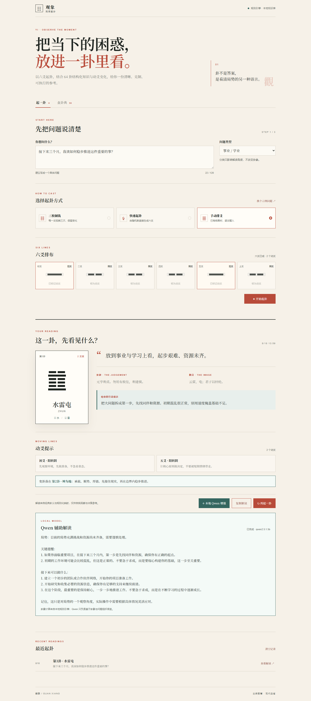

# 观象 · 周易解卦

一个本地运行的周易 64 卦解读工具。规则引擎负责计算本卦、动爻和变卦，本地 Qwen 模型负责生成辅助解读。



## 部署方式

本项目采用本机部署。GitHub 只保存代码，不需要上传 Ollama 程序或 Qwen 模型；每个使用者在自己的电脑上安装和下载即可。

### 1. 准备环境

- 安装 [Node.js 18 或更高版本](https://nodejs.org/)
- 从 [Ollama 官网](https://ollama.com/download) 下载并安装 Ollama
- 下载本项目代码并进入项目目录

### 2. 下载并启动 Qwen

先打开 PowerShell 或终端，启动 Ollama：

```powershell
ollama serve
```

保持这个窗口运行，再打开一个新的终端下载模型：

```powershell
ollama pull qwen2.5:1.5b
```

Windows 安装 Ollama 后通常会自动启动服务。如果 `ollama serve` 提示端口已被占用，说明服务已经运行，可以直接下载模型。

### 3. 配置项目

Windows PowerShell：

```powershell
Copy-Item .env.example .env
```

macOS / Linux：

```bash
cp .env.example .env
```

默认配置会连接 `http://127.0.0.1:11434/v1`，使用 `qwen2.5:1.5b`。

### 4. 启动网页

```powershell
node server.js
```

浏览器打开：<http://127.0.0.1:8765>

## 上传 GitHub

正常上传项目代码和 `docs/app-preview.png` 即可。不要上传以下内容：

- `.env`
- Ollama 安装包
- `.ollama` 模型目录
- `node_modules`

这些内容已经由 `.gitignore` 排除或存放在项目目录之外。其他人克隆代码后，按照上面的步骤自行安装 Ollama 和下载模型。

> GitHub Pages 只能运行静态页面，不能直接访问用户电脑上的 Ollama。需要本地 Qwen 功能时，请使用 `node server.js` 在本机运行。
